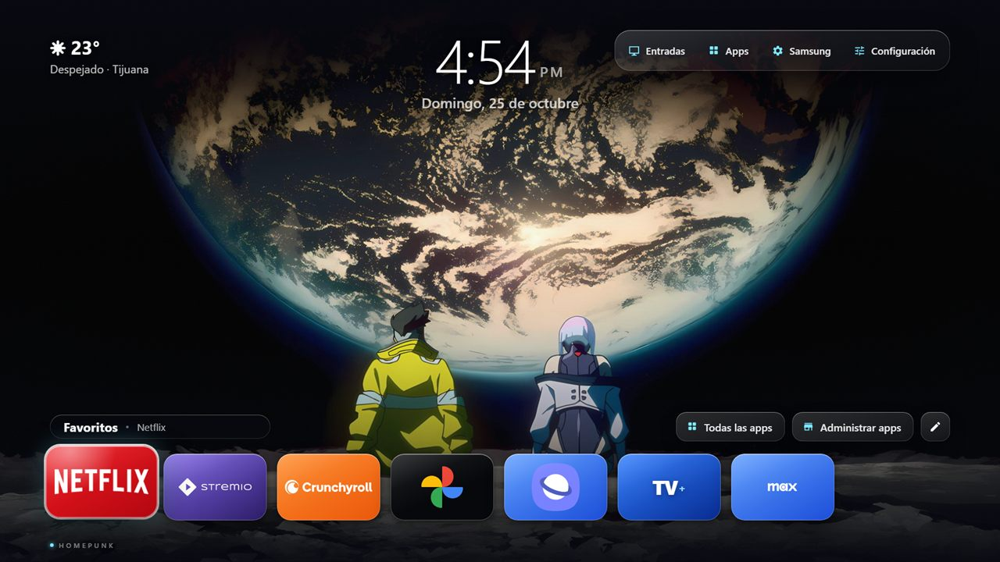
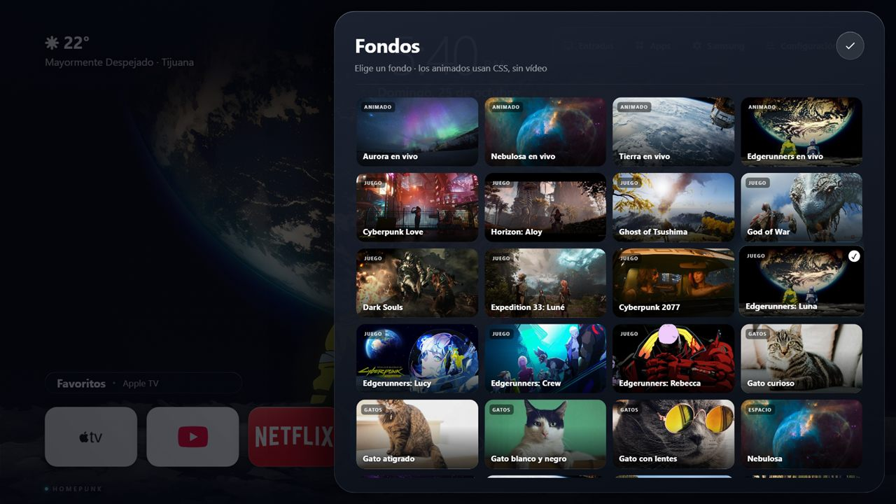

# HomePunk / ArturoPro

Launcher personal para **Samsung Tizen TV**. Reemplaza visualmente la pantalla
de inicio con una interfaz propia, sin modificar el firmware.

> **Usado en:** Samsung `UN43M70HAFXZX` (M70H, Tizen 10, firmware
> `T-KSU2EHAKUC-1203.9`).
> **Versiones:** HomePunk `0.7.25` + servicio `ArtWatch1.WatchService` `1.6.3`.
> **AppID:** `ArtHome002.Launcher` · **Paquete:** `ArtHome002`.

Proyecto personal, sin afiliación con Samsung. No incluye certificados,
contraseñas ni claves de firma.




## Video

[Ver demo de HomePunk](media/homepunk-demo.mp4)

## Qué incluye

- Favoritos con apps reales de Tizen, reordenables con **long-press OK**.
- Entradas HDMI con dispositivo y logo.
- Apps: Internet, Samsung TV Plus, Google Fotos y catálogo instalado.
- Fondos animados CSS/GPU y fondos estáticos 1080p.
- Ajustes de tema, clima, auto-retorno, arranque y administración de apps.
- Regreso a HomePunk al pulsar Home, mediante ArtWatch.

## Cómo funciona el retorno a HomePunk

La TV abre Samsung Home al pulsar Home. ArtWatch observa la app que tiene el
foco y, cuando detecta Samsung Home, abre HomePunk mediante AppControl:

```text
Home
  ↓
Samsung Home
  ↓  ArtWatch detecta el foco
AppControl → ArtHome002.Launcher
  ↓
HomePunk
```

El servicio:

1. corre en segundo plano como app de servicio Tizen;
2. lee la app en foco;
3. cuando aparece Samsung Home, abre HomePunk;
4. no modifica el firmware ni la pantalla de inicio del sistema.

En la práctica se ve un flash breve de Samsung Home y luego HomePunk. El tiempo
puede variar según la app anterior y el estado de la TV.

Endpoints de control (solo LAN local, sin autenticación):

```text
GET  /status
POST /start
POST /stop
POST /boot/on
POST /boot/off
```

> **Seguridad:** el endpoint no tiene autenticación. No lo expongas a Internet
> ni lo publiques en una red que no controles.

Detalle: [`docs/WATCHER-RETURN.md`](docs/WATCHER-RETURN.md).

## ¿ArtWatch necesita Wi-Fi?

**No para el retorno local.** El servicio observa el foco y abre HomePunk dentro
de la misma TV; no depende de Internet.

- **Retorno al launcher:** funciona sin Wi-Fi.
- **Panel desde el launcher:** usa `127.0.0.1:47998`; también funciona sin red.
- **Control desde PC:** requiere estar en la misma LAN (Wi-Fi/Ethernet), pero no
  Internet.
- **Instalar o actualizar:** requiere la herramienta de instalación de Tizen por
  red o USB; después de instalado no necesita red.
- **Clima:** es opcional y usa Open-Meteo; sin Internet muestra “sin conexión”.
- La telemetría de emulador está desactivada por defecto; solo se activa con
  `ARTWATCH_TELEMETRY=1`.

## Apps y repositorios

El launcher abre apps instaladas por AppID. **No incluye el código de YouTube,
Netflix, Samsung TV Plus ni de las demás apps de terceros**; cada una pertenece
a su dueño y se instala desde su tienda o paquete correspondiente.

| Uso | AppID |
|---|---|
| Launcher | `ArtHome002.Launcher` |
| Watcher | `ArtWatch1.WatchService` |
| Samsung Home | `com.samsung.tv.csfs` |
| YouTube | `9Ur5IzDKqV.TizenYouTube` |
| Netflix | `org.tizen.netflix-app` |
| Samsung TV Plus | `HEPsqFNie0.tvplusstandalone` |
| Internet | `org.tizen.browser` |
| Google Fotos | `com.samsung.tv.google-photos-ui` |

Esos IDs se usan para lanzar apps ya instaladas; no se redistribuyen sus
binarios. Cada usuario instala sus apps desde su tienda o paquete.

Herramientas y referencias del proyecto:

- **Tizen Studio / TV SDK** para compilar, firmar e instalar.
- **Node.js + Vite + Preact/React** para el launcher web.
- **`simple-icons`** para algunos logos.
- **Open-Meteo** para el clima opcional.
- **[Samsung/tizen-docs](https://github.com/Samsung/tizen-docs)** y
  **Samsung Developer** para APIs y compatibilidad.
- **[Apps2Samsung](https://github.com/Apps2Samsung/Apps2Samsung)** como
  herramienta externa de instalación; no forma parte del launcher y no se
  incluye su código en el build.

## Compatibilidad con otras TV Samsung

El build actual está pensado para **Tizen 10 / 2026** (`api-version="10.0"`,
`net6.0`, Tizen.NET 10). No es un binario universal: una TV de 2015–2025 no
instalará este build tal cual.

- **Tizen 4.0+ (2018+):** la arquitectura del watcher es portable, pero hay que
  recompilar para la versión de Tizen y el runtime .NET de cada modelo.
- **Tizen 2.3–3.0 (2015–2017):** no hay Tizen .NET TV; hace falta un servicio
  nativo C/C++ o un servicio web. No está verificado.
- **Tizen 10 (2026):** único entorno de referencia.

La matriz completa y el plan de portado están en
[`docs/COMPATIBILIDAD-TIZEN.md`](docs/COMPATIBILIDAD-TIZEN.md). El alcance del
emulador está en [`docs/EMULADOR-TIZEN.md`](docs/EMULADOR-TIZEN.md) y los repos
de referencia por versión en
[`docs/GITHUB-REFERENCIAS.md`](docs/GITHUB-REFERENCIAS.md).

> La compatibilidad depende del runtime disponible y de que la TV permita el
> servicio en segundo plano. No se debe asumir que un solo WGT/TPK funcione en
> todas.

## Activar Developer Mode en la TV

1. Conecta la TV y la PC a la misma red.
2. En la TV abre **Smart Hub > Apps**.
3. En el panel de Apps, escribe **`12345`** con el control numérico. En algunos
   modelos aparece un teclado en pantalla.
4. Activa **Developer Mode**.
5. En **Host PC IP**, pon la IPv4 de tu PC (la ves con `ipconfig`).
6. Acepta y **reinicia la TV**.
7. Desde la PC:

   ```powershell
   C:\tizen-sdk\tools\sdb.exe connect <TV_IP>:26101
   C:\tizen-sdk\tools\sdb.exe devices
   ```

Debe aparecer la TV como `device`. Si no aparece, revisa la IP, que sea la misma
red y que Developer Mode siga activo después del reinicio.

En modelos antiguos el menú puede cambiar; el código `12345` se introduce desde
el panel de Apps, no desde Ajustes generales.

## Ruta rápida

Descargas necesarias:

- [Node.js 20+](https://nodejs.org/en/download)
- [.NET SDK](https://dotnet.microsoft.com/download)
- [Tizen Studio](https://developer.tizen.org/development/tizen-studio/download)
- [Samsung TV Extension para Tizen Studio](https://developer.samsung.com/smarttv/develop/tools/tv-extension/download.html)
- [Certificados Samsung](https://developer.samsung.com/smarttv/develop/getting-started/setting-up-sdk/creating-certificates.html)
- [Activar Developer Mode en la TV](https://developer.samsung.com/smarttv/develop/getting-started/using-sdk/tv-device.html)

> Para Tizen 2.3/2.4 Samsung ya no publica las TV Extension específicas; el
> archivo 3.1.2/4.0b se usa como fallback no oficial. Para 4.0–9.0 hay que usar
> la extensión de esa versión y recompilar. Ver
> [`docs/EMULADOR-TIZEN.md`](docs/EMULADOR-TIZEN.md).

Comprobación rápida del entorno:

```powershell
powershell -ExecutionPolicy Bypass -File tools/check-setup.ps1
```

1. Instala **Node.js 20+**, **.NET SDK** compatible y **Tizen Studio** con el TV SDK.
2. Crea tu propio perfil de firma en Tizen Studio (no se incluye ninguno).
   Detalle: [`docs/FIRMA-TIZEN.md`](docs/FIRMA-TIZEN.md).
3. Compila el launcher:

   ```powershell
   npm ci
   npm run build
   tizen package -t wgt -s <signing-profile> -- dist
   tizen install -n "HomePunk.wgt" -s <TV_IP>:26101 -- dist
   ```

4. Compila e instala el watcher:

   ```powershell
   tizen build-cs -C Release -s <signing-profile> -- native/ArtWatchTv
   tizen install -n "ArtWatch1-1.6.3.tpk" -s <TV_IP>:26101 -- native/ArtWatchTv/bin/Release/net6.0
   ```

5. Abre HomePunk. El servicio ArtWatch queda activo.

No se necesita Internet para el retorno local.

## Tiempo de instalación

Con Tizen Studio, el perfil de firma y Developer Mode ya listos:

| Paso | Tiempo |
|---|---:|
| Firmar WGT | 5–20 s |
| Compilar/firmar TPK | 5–20 s |
| Instalar WGT + TPK | 20–60 s |
| **Total** | **1–3 min** |

Si falta el perfil/certificado: **10–30 min** más.
Si hay que instalar Tizen Studio desde cero: **30–60 min** más.

## Estructura

```text
src/                 Launcher React/Preact, estilos y lógica
public/              iconos, logos y wallpapers
media/               video de demostración
native/ArtWatchTv/   servicio de retorno (C#/Tizen)
docs/                método de retorno, compatibilidad y documentación
tools/               comprobación de entorno
```

## Límites

- No es un Home nativo: la TV muestra brevemente Samsung Home y luego HomePunk.
- Depende de que Tizen mantenga vivo el servicio en segundo plano.
- El endpoint HTTP no tiene autenticación.
- No sobrevive a cambios de firmware que retiren las APIs usadas.
- No reemplaza la pantalla de inicio del sistema.
- No es una app para publicar en Samsung Apps TV sin revisar antes las políticas
  de la tienda; está pensada para instalación de desarrollador.

## Marcas y derechos

Los logos de apps y los fondos de juegos son marcas/arte de sus respectivos
propietarios. Se incluyen solo para uso personal en la TV del autor. No se
incluyen certificados, claves ni material de Samsung.

## Estado

- HomePunk `0.7.25` visible y en ejecución.
- ArtWatch `1.6.3` con auto-retorno y arranque.
- La compatibilidad con Tizen anteriores está **pendiente de portado**.
